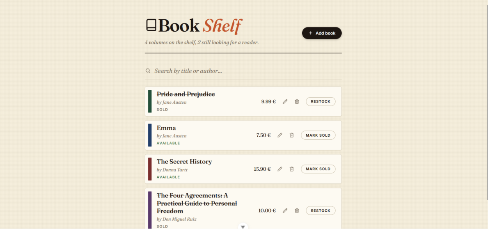
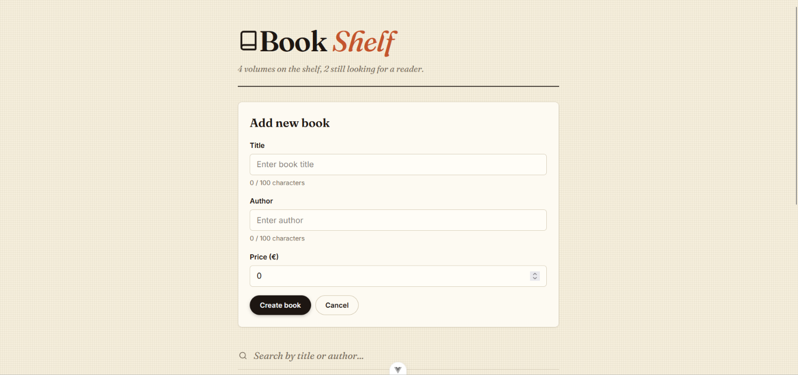

# Book List

A small full-stack app for managing a shelf of books: a **.NET Web API** with a **SQL Server** database, and a **Vue 3** frontend.

You can list, search, add, edit and delete books, and mark a book as sold (or available again).

## Tech stack

| Part | Technology |
|---|---|
| Backend | .NET 10, ASP.NET Core Web API (controllers), Entity Framework Core 10 |
| Database | SQL Server (developed against SQL Server Express) |
| Frontend | Vue 3 (Composition API, `<script setup>`), Vite, `lucide-vue-next` icons |
| API docs | Swagger UI |

## Features

- List all books, with a search box that filters by title or author
- Add a new book (the form opens with the **Add book** button)
- Edit a book's title, author and price
- Delete a book 
- Mark a book as **sold**, and bring it back with **Restock**
- Validation with clear messages: required title and author, 100 character limit, and no duplicates
- Hover tooltips on the action buttons, and cards that lift slightly on hover

##  Screenshots


| Book List | Add Book |
|---|---|
|  |  | 

## Book data

| Field | Type | Rules |
|---|---|---|
| `id` | int | Generated by the database |
| `title` | string | Required, max 100 characters |
| `author` | string | Required, max 100 characters |
| `price` | decimal | 0 to 99999.99 |
| `isSold` | bool | `false` by default |

**No two books can have the same title and the same author.** This is checked in the controller (returning `409 Conflict` with a clear message) and also enforced by a unique index in the database. The comparison ignores letter case, because SQL Server's default collation is case-insensitive.

## API endpoints

Base URL: `http://localhost:5107/api/books`

| Method | Route | Description | Success | Errors |
|---|---|---|---|---|
| GET | `/api/books` | List all books | 200 | |
| GET | `/api/books/{id}` | Get one book | 200 | 404 |
| POST | `/api/books` | Create a book | 201 | 400, 409 |
| PUT | `/api/books/{id}` | Update a book (the `id` in the URL must match the body) | 204 | 400, 404, 409 |
| DELETE | `/api/books/{id}` | Delete a book (returns the deleted book) | 200 | 404 |
| PATCH | `/api/books/{id}/sold` | Mark a book as sold | 204 | 404 |
| PATCH | `/api/books/{id}/available` | Mark a book as available again | 204 | 404 |

Status codes in short: `400` means validation failed (or the ids don't match), `404` means the book doesn't exist, and `409` means a book with that title and author already exists.

### Backend structure

The backend is a single project with a simple folder layout:

- **Controllers**: `BooksController` holds the endpoints and the rules (duplicate check, sold flag)
- **Models**: the `Book` entity and its validation attributes
- **Data**: `AppDbContext`, including the unique index
- **Migrations**: EF Core migrations

`AppDbContext` is registered in `Program.cs` with `AddDbContext` and injected into the controller through its constructor.

## Getting started

### Prerequisites

- [.NET SDK 10](https://dotnet.microsoft.com/download)
- SQL Server Express (or any SQL Server instance)
- [Node.js](https://nodejs.org/) (LTS) and npm
- The EF Core command-line tool:
  ```
  dotnet tool install --global dotnet-ef --version 10.0.*
  ```

### 1. Database and backend

1. Open `BooksApi/appsettings.json` and check the connection string. It defaults to a local SQL Server Express instance with Windows Authentication:
   ```json
   "ConnectionStrings": {
     "DefaultConnection": "Server=.\\SQLEXPRESS;Database=BooksDb;Trusted_Connection=True;TrustServerCertificate=True;"
   }
   ```
   If your server has a different name (for example `.\\SQLEXPRESS01`, or `(localdb)\\MSSQLLocalDB`), change the `Server=` part.

2. Create the database from the included migrations:
   ```
   cd BooksApi
   dotnet ef database update
   ```
   This creates the `BooksDb` database and the `Books` table.

3. Run the API:
   ```
   dotnet run
   ```
   The terminal prints the address, for example `http://localhost:5107`. Open `http://localhost:5107/swagger` to try the endpoints.

### 2. Frontend

In a second terminal:

```
cd frontend
npm install
npm run dev
```

Open `http://localhost:5173`.

### Ports

The frontend and backend need to agree on two addresses:

- **API address:** set in `frontend/src/api/books.js` (`API_URL`, default `http://localhost:5107/api/books`). If your API starts on a different port, change it there.
- **Frontend address:** the API allows requests from `http://localhost:5173` (the CORS policy in `Program.cs`). If Vite uses another port, update `WithOrigins(...)`.
